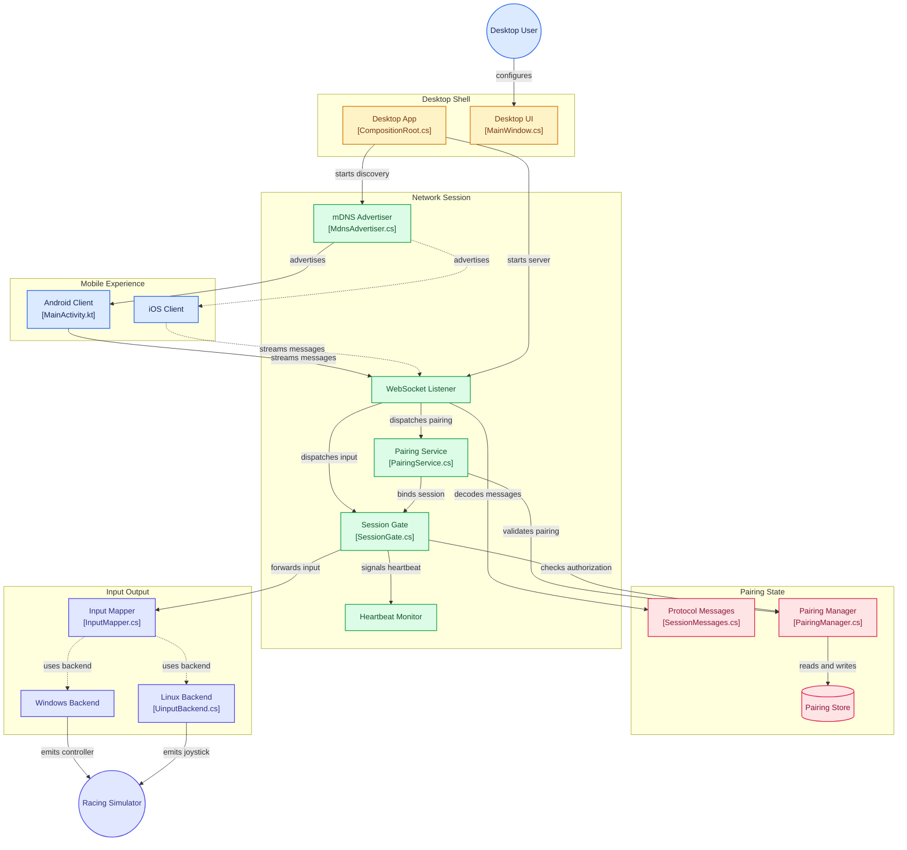

# WheelDeck

Project Status: **Alpha** — `v0.1.0-alpha.1` prereleased from `main`.

Turn an Android phone into a steering wheel and dashboard control panel for PC racing and trucking simulators. A desktop companion app translates the phone's input into a virtual game controller the simulator reads natively.

Runs on Linux and Windows desktops paired with an Android phone.

Primary target: Euro Truck Simulator 2.

## How it works

[](https://gitdiagram.com/fazrigading/wheeldeck?utm_source=readme&utm_medium=picture)



1. Phone captures gyroscope steering, touch pedals, and dashboard button presses
2. Phone discovers the desktop server on the local network via mDNS
3. One-time PIN pairing establishes a session
4. State and button messages stream over WebSocket in real time
5. Desktop app drives a virtual Xbox controller (Windows/HIDMaestro) or joystick (Linux/uinput)
6. Simulator reads the virtual controller natively — no game plugins needed

## Components

| Directory | Stack | Description |
|-----------|-------|-------------|
| `android/` | Kotlin 2.x + Jetpack Compose | Phone app — sensor capture, WebSocket client, on-screen dashboard |
| `desktop/` | C#/.NET 10 + Avalonia UI | Desktop server — WebSocket listener, virtual controller backend, pairing |
| `protocol/schema/` | JSON Schema | Shared message formats and control enums (single source of truth) |

## Release status

- Current: `v0.1.0-alpha.1` (tag on `main`). GitHub Release is a **prerelease** with generated notes.
- Tag push matching `v*` triggers `.github/workflows/release.yml`: Android APK, Windows x64 zip, Linux x64 tarball.
- Android alpha is signed with debug keys (`android/app/build.gradle.kts`); real signing lands before stable.
- The alpha above predates the Kotlin rewrite: it was cut from the Flutter app. The
  Kotlin app in `android/` has never been run on a device. The next tag will be
  the first to ship it, and it should not be called a regression from alpha.

## Migration: phone app Flutter → Kotlin

- Done. The native Android app (Kotlin + Jetpack Compose, Material 3, single `:app`
  module) replaced the Flutter app, which is deleted. The Dart source is preserved
  on the `backup/flutter-port` branch.
- Plan and per-task acceptance criteria: [`plan/finished/migration-kotlin-1.md`](plan/finished/migration-kotlin-1.md).
  What the cutover cost, and what is still unverified: [`tasks/task-12-leftovers.md`](tasks/task-12-leftovers.md).
- Seven `TODO.md` Mobile items were built as acceptance criteria rather than
  ported as bugs. Five are shipped; two are implemented but device-unverified.
- iOS has no client. The release workflow built a PWA from the Flutter web build,
  and there is no web target now — it was P2 and never served natively.

## Project structure

See [`docs/project-structure.md`](docs/project-structure.md) for the full repository layout.

## Quick start

### Phone app

Needs JDK 21 and an Android SDK with platform 37.

```bash
cd android
./gradlew installDebug
```

### Desktop server

```bash
cd desktop
dotnet build
dotnet run --project WheelDeck.App
```

Linux: run `scripts/linux/install-uinput-rules.sh` from the repo root, then apply the commands it prints. Covers Fedora/RHEL, Ubuntu/Debian derivatives (Mint, Pop!_OS, Zorin), and Arch-based (CachyOS, Manjaro, EndeavourOS).

See `docs/mobile-dev-guide.md` and `docs/desktop-dev-guide.md` for full setup instructions including platform-specific driver requirements.

## Supported platforms

| Platform | Status | Driver | Virtual controller |
|----------|--------|--------|--------------------|
| Android  | P0 | Native     | Fully functional    |
| Windows  | P1 | HIDMaestro | XBOX 360 Controller |
| Linux    | P0 | uinput     | Virtual Joystick    |

## Docs

Full specs, guides, and architecture decisions: [`docs/`](docs/)

On-device verification steps for the phone app: [`tasks/manual-checklist.md`](tasks/manual-checklist.md).
